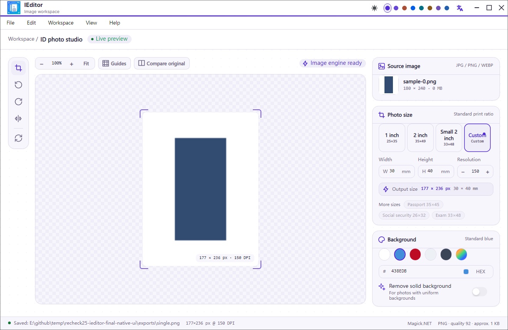
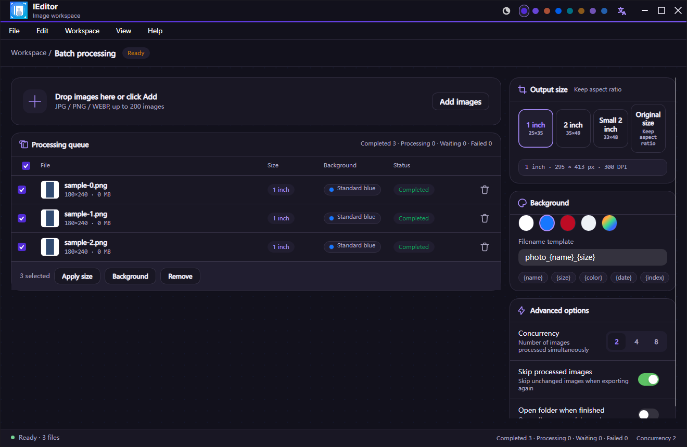

<p align="center"></p>

# IEditor 证件照处理

基于 Avalonia 的本地证件照工具。当前版本：**0.3.13**。

- 单张处理：一寸、二寸及自定义毫米尺寸，DPI、背景颜色、旋转、镜像、缩放、拖动与原图对比，支持 JPG、PNG 导出。
- 背景处理：支持去除均匀纯色背景；复杂发丝和复杂场景不在当前算法范围内。
- 批量处理：拖放和文件夹导入、重复过滤、最多 200 张、统一规格、文件名模板、2/4/8 并发、跳过未变化的已处理文件及 ZIP 导出。启动队列不包含虚构任务。
- 外观与语言：Semi、Ursa、CodeWF 组件系；浅色、深色、跟随系统，八套主题色，即时切换简体中文和英文并保存偏好。
- 关于与更新：真实版本和编译时间，通过 CodeWF.Toolkit 完成检查、下载、校验、安装、取消及异常恢复。





以上两张截图来自 0.3.13 本地候选版本的独立 Windows NativeAOT 界面验证器，使用真实视图与 Skia 离屏渲染；不代表人工桌面或安装器操作验收。源码指纹和图片 SHA-256 见 [本轮媒体复核](docs/recheck25-native-media.md)。本机验证记录不替代 GitHub Release 发布状态。

## 运行与验证

需要 .NET 10 SDK。所有 CodeWF 引用均来自 NuGet，无跨仓库项目引用。

```powershell
dotnet run --project src/IEditor.App/IEditor.App.csproj
dotnet test --project tests/IEditor.Core.Tests/IEditor.Core.Tests.csproj -c Release
pwsh scripts/sync_localization_keys.ps1 -Check
dotnet run --project scripts/ui-verification/UiVerification.csproj -c Release -- artifacts/ui-managed
```

宿主翻译 JSON 输出到程序目录；`Language.tt` 生成强类型键。业务和内嵌库资源共用 `CodeWF.Toolkit.Lang.I18nManager.Instance`，宿主同名键自动覆盖库资源。

## 原型与发布

[design/index.html](design/index.html) 是可复制后离线使用的单文件交互原型；维护和自动审计说明见 [design/README.md](design/README.md)。

[界面验证记录](docs/UI-VERIFICATION.md) 记录了同尺寸原型对照、真实行为和 NativeAOT 验证边界。发布入口为 `pwsh scripts/publish.ps1 -RuntimeIdentifier win-x64`，完整流程见 [docs/RELEASE.md](docs/RELEASE.md)。GitHub 版本工作流分别在原生 runner 生成 Windows exe、Linux x64/arm64 deb、macOS x64/arm64 dmg 安装包及 SHA-256 校验文件。
